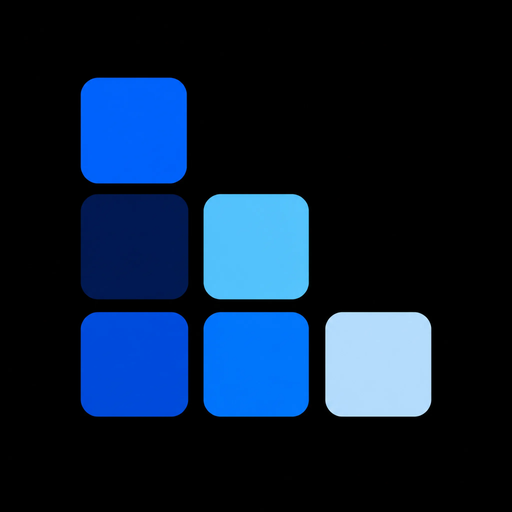
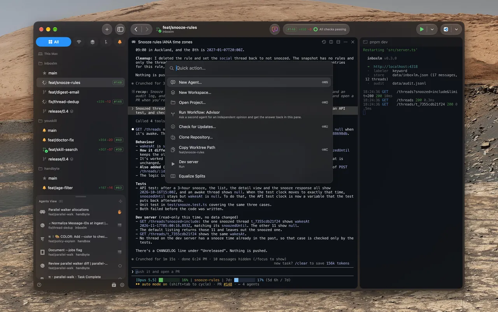

<p align="center">
  
</p>

<h1 align="center">Codans</h1>

<p align="center">
  <strong>Run your coding agents in parallel, in one window.</strong>
</p>

<p align="center">
  <a href="https://codans.dev">Website</a> ·
  <a href="CHANGELOG.md">Changelog</a> ·
  <a href="https://github.com/wanggang316/codans/releases">Releases</a>
</p>

<p align="center">
  
</p>

Codans is a native macOS terminal for people who work through coding agents. It gives every task a worktree, every agent a pane, and shows you which ones are working and which ones need you.

## Features

### Built around the agent, not the editor

Codans knows which panes run agents and what state each one is in. It can start, queue, resume, and hand over their work.

- **Agents View**: every agent in every project, with its live state. Click a row to go to its pane.
- **New Agent**: press <kbd>⌘⇧N</kbd>, pick a project, name a branch, write the prompt. The worktree and the agent start together.
- **Command Queue**: line up prompts while the agent is busy: after the current task, now, or on a schedule.
- **Session History**: every Claude Code and Codex session of a worktree. Resume one in a new tab, in place, or in a split.
- **Agent Profiles**: launch presets with agent, model, effort, mode, placement, arguments, and environment.
- **Workflows** (beta): hand a task to another agent with a briefing, or chain agents into loops such as author and reviewer.
- **Notifications**: a bell marks the worktree where an agent asked or finished. A macOS banner takes you to the pane.
- **Sessions outlive the window**: quit Codans and the agents keep working. The next launch brings every terminal back.
- **CLI and Agent Skill**: everything in the window is a `codans` command. Agents use it to create worktrees, start other agents, and read their output.

Works with Claude Code, Codex, OpenCode, Pi, omp, Gemini CLI, and anything else with a CLI.

### Work in many worktrees at the same time

Give each task its own worktree and let them all move at once.

- **One task, one worktree**: each worktree has its own directory, branch, tabs, and panes. Agents never edit the same checkout.
- **State in the sidebar**: diff size, pull request, running commands, and unread bells for every worktree.
- **Switch without losing your place**: tabs and split layouts stay as you left them, across restarts.
- **Built for many terminals**: deeply optimized for many terminals that work in parallel. Memory stays low, and terminals that you have not opened stay asleep.

### The pull request, from open to merged

Codans reads pull requests through the `gh` and `glab` CLIs that you are already logged in to. It sends no HTTP request of its own and stores no token.

| | GitHub | GitLab |
|---|---|---|
| Pull request and merge request badges | ✓ | ✓ |
| Check and pipeline status | ✓ | ✓ |
| Merge commit | ✓ | ✓ |
| Squash and merge | ✓ | ✓ |
| Rebase and merge | ✓ | The project's merge method applies |
| Mark ready for review | ✓ | ✓ |
| Rerun failed checks or pipeline jobs | ✓ | ✓ |
| Review status | ✓ | ✓ |

GitLab works on gitlab.com and on self-managed instances.

### Many repositories, local or remote, in one place

- **Workspaces**: put several projects in one space and work on them like a monorepo: one branch name, one checkout in each project, one place for your agents.
- **Remote projects**: work on a project on another machine as if it were local. Its terminals run over a persistent SSH session.
- **Filters**: cut the sidebar down to remote projects, workspaces, worktrees with a pull request, or worktrees with unread notifications.

### Themes

Every Ghostty theme is built in, 463 of them. Choose one for light and one for dark; the window follows the system and takes its colors from the terminal.

### Quick actions

- **Command palette**: <kbd>⌘P</kbd> finds every action.
- **Run commands**: bind build, test, and dev-server commands to the Run button. Codans finds the scripts in your project files.
- **Shortcuts**: every action has a shortcut that you can change.
- **Open in your editor**: <kbd>⌘O</kbd> opens the worktree in VS Code, Cursor, Zed, Xcode, or a JetBrains IDE.

## Install

```bash
brew install --cask wanggang316/tap/codans
```

The cask installs `Codans.app` into `/Applications` and symlinks the embedded `codans` CLI into Homebrew's `bin`. Subsequent updates flow through the in-app Sparkle updater; `brew upgrade --cask codans` also picks up new stable releases.

## Running Codans

Requires macOS **14 (Sonoma) or later**. Xcode and mise are only needed to build
from source.

1. Open Codans and add a project directory from the sidebar.
2. Select its root worktree, or create a worktree for a separate line of work.
3. Run a coding agent in the terminal; use tabs and split panes for parallel tasks.

For CLI usage, see the [Agent Skill](skills/codans-cli/SKILL.md).

## Build from Source

### Development requirements

- Xcode **26 or 27** (pinned via `apps/mac/Tuist.swift`)
- [`mise`](https://mise.jdx.dev/) for tool version pinning (`tuist`, `zig`, `swiftlint`, `xcbeautify`, `xcsift`)

### Generate, build, and run

```bash
# One-time per worktree
mise trust . apps/mac
make bootstrap            # init submodules (ghostty, git-wt) + mise install

# Generate + build + run
make mac-generate         # tuist install + tuist generate (builds Ghostty xcframework)
make mac-build            # build Codans.app + codans CLI
make mac-run-app          # build + open the app
```

> First-time Ghostty build is ~3.9 GB / ~20 min. In additional worktrees, symlink the cache:
> `ln -s <main>/apps/mac/.build/ghostty apps/mac/.build/ghostty`

### Development commands

| Command | Description |
|---|---|
| `make bootstrap` | Init submodules + `mise install` |
| `make mac-generate` | Generate `codans.xcworkspace` from Tuist |
| `make mac-build` | Build the Mac app + `codans` CLI |
| `make mac-run-app` | Build and launch `Codans.app` |
| `make mac-lint` | Run `swiftlint --quiet` |
| `make mac-check` | `swift-format` in-place + lint |
| `make mac-test` | Run the Codans, CodansCore, and CodansKit test schemes |
| `make mac-release` | Archive → notarize → DMG → staple |
| `make help` | Full target list |

The top-level `Makefile` delegates every `mac-*` target to `apps/mac/Makefile`.

## Documentation

All project knowledge lives in [`docs/`](docs/):

- [Architecture](docs/architecture.md) — domains, layers, dependency rules
- [Product spec](docs/product-spec.md) — what the product is
- [Design docs](docs/design-docs/) — feature and system designs

Agent-facing entry point: [`AGENTS.md`](AGENTS.md) (also exposed as `CLAUDE.md`).

## License

Codans is open source under the [MIT License](LICENSE).
